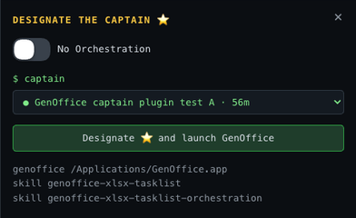
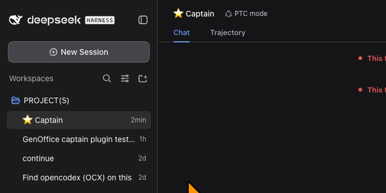

# dsh-genoffice-captain

A DeepSeek Harness (DSH) plugin for GenOffice task lists. When a session invokes `GenOffice_XLSX_Tasklist` or `/GenOfficeXLSXTasklistOrchestration`, it launches GenOffice straight away for solo work, or first opens a **DESIGNATE THE CAPTAIN ⭐** pane so you can choose which session orchestrates.

 

## What it does

- **Trigger.** A message you send that names either skill (`GenOffice_XLSX_Tasklist`, `/GenOfficeXLSXTasklistOrchestration`, or the DSH names `/genoffice-xlsx-tasklist` and `/genoffice-xlsx-tasklist-orchestration`), or the agent loading either skill with the `skill` tool.
- **One active session:** GenOffice is launched (or brought forward) and nothing else happens.
- **Several active sessions:** a pane opens over the right quarter of the window (the session sidebar on the left stays visible) with the header DESIGNATE THE CAPTAIN ⭐, a **No Orchestration** switch and a dropdown of the open and active sessions, listed by session name and age (● running, ○ idle; running or used in the last 6 hours, sub-agents excluded). A session without a title yet shows as `Untitled session <id>`; its working folder appears only as the tooltip.
  - Flip **No Orchestration** and GenOffice launches with no Captain. The choice is remembered for that session, so its later triggers launch GenOffice directly.
  - **Designate ⭐** renames the chosen session to `⭐ <title>` (`⭐ Captain` if it has no title yet), takes the star off any previous Captain, queues a message telling it that it is the Captain (the message starts with `/genoffice-xlsx-tasklist-orchestration`, so DSH loads that skill) and launches GenOffice.
- Once a Captain exists, the agent loading the skill again does not reopen the pane; typing a skill name yourself does.
- On start it copies the two bundled skills into `~/.dsh/skills` under DSH-valid names (`genoffice-xlsx-tasklist`, `genoffice-xlsx-tasklist-orchestration`) when they are missing. It never overwrites an existing copy.

## Requirements

- DeepSeek Harness with DSH Web or DSH Desktop. Tested with DSH Desktop 2.0.13 (dsh 0.1.5-rc.2) on macOS.
- [GenOffice](https://github.com/genspark-ai/genoffice) on macOS (`/Applications/GenOffice.app`), Windows (`%LOCALAPPDATA%\Programs\GenOffice\GenOffice.exe`) or Linux (`/opt/GenOffice/genoffice`, `/usr/bin/genoffice`, `/usr/local/bin/genoffice`, `~/Applications/GenOffice.AppImage`). Set `GENOFFICE_PATH` for any other location.
- The two skills ship inside the plugin. The pane lists what it found.

## Install

DSH Web or any CLI profile:

```sh
dsh plugin --profile web add github:rajpaulsingh6-stack/dsh-genoffice-captain
```

DSH Desktop (its profile is managed by the app, so add the package in the profile folder and list it as a bundle, then restart DSH Desktop):

```sh
cd ~/.dsh/profiles/desktop
pnpm add github:rajpaulsingh6-stack/dsh-genoffice-captain
# then add "dsh-genoffice-captain" to dsh.profile.bundles in package.json
```

The plugin is plain JavaScript with no dependencies and no build step, so a GitHub install needs no build permission.

## Security

The plugin's routes (`/api/genoffice-captain/*`) answer loopback requests only, and launching needs a POST with a custom header, so other web pages cannot trigger it. It only ever starts the GenOffice app; it never runs text from a message.

## Check

```sh
node test.mjs
```

## Credits

Created by **Rajpaul Singh**, built with Claude (Anthropic's AI assistant). The bundled skills are Rajpaul Singh's GenOffice_XLSX_Tasklist and GenOfficeXLSXTasklistOrchestration; the orchestration skill adapts ideas from [sub-agents-skills](https://github.com/shinpr/sub-agents-skills) by Shinsuke Kagawa (MIT) and [Orca](https://github.com/stablyai/orca) by stablyai (MIT), see its NOTICE.md. GenOffice is by Genspark. MIT License.
